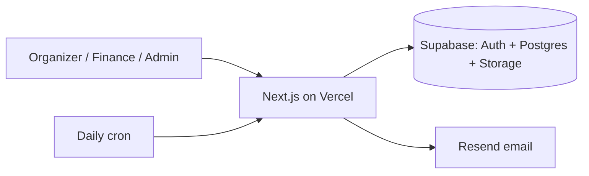
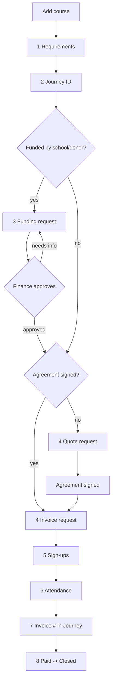

# SKYCampusConnect Plan (v2)

Revision of `plan.md`, grounded in `docs/forms/01-03`. Original left untouched.

## Part A: Improvements to v1, and why

| # | Gap in v1 | Why it matters | Fix in v2 |
|---|---|---|---|
| 1 | DB has only `profiles` + `courses` | Forms 1-3 need funding requests, quotes, invoices, clients, documents. Single `courses` table would bloat and lose history | Full schema (see Data model) |
| 2 | Steps are a linear 1-8 "current step" int | Real flow branches: school-funded vs not (step 3), quote vs invoice vs waived (step 4). Steps 5/6 overlap in time | Per-step status rows + routing rules; derived "current step" |
| 3 | No approval workflow | Step 3 ($0 request) and Step 4 (quote/invoice #) are Finance-issued; organizer waits 1-10 days | Request -> Finance queue -> issued; statuses + SLA ages |
| 4 | Admin only sends reminders | Finance does the work: approve funding, enter quote #, enter invoice #. Without this the Finance spreadsheet isn't replaced | Finance role + queues with inline actions |
| 5 | Single `admin` role | Finance/IAHV admin/campus staff need different powers | Roles: organizer, admin, finance |
| 6 | Re-typing data across 3 forms | Same ~10 fields (client, course, dates, Journey ID, POC) appear in every form; main pain point | Capture once on `courses`/`clients`; forms prefilled, organizer only confirms |
| 7 | Manual pricing | Hand-calculated amounts are error-prone | Computed: $500 / $1,000 base (<=10) + $100 per extra; +3% card fee |
| 8 | Reminders = manual bulk send | Pain is forgotten invoices; staff shouldn't have to remember to remind | Rule-based automatic reminders + manual bulk send; log of sends |
| 9 | No document handling | Proof of funds / formal agreement uploads duplicated across forms | Supabase Storage + `documents`, reused by reference |
| 10 | No Journey integration/assumption stated | Journey status is the source of truth for closure; no API assumed | Manual status entry + copy-ready text helpers; open question tracked |
| 11 | No gating logic | Form 1 "previous courses closed?" can be computed; invoice needs agreement | Computed eligibility + blocking messages |
| 12 | No audit trail | Finance disputes (who approved, when, which amount) | `events` log table |
| 13 | Email infra unspecified | "Send emails" needs a provider, templates, bounce handling | Resend (or Supabase + SMTP), template table, send log |
| 14 | No auth restriction / onboarding | Anyone could sign up as organizer or admin | Magic link/SSO restricted by domain/invite; admin roles set by admins only |
| 15 | No validation/UX rules | Forms demand full university names, date ranges, PDFs <=10 MB | Shared validators |
| 16 | No testing/privacy plan | Invoices are confidential | RLS tests, demo-safe seed data, no real amounts in repo |
| 17 | Build order skips data foundation and ends on emails | Biggest value (invoice tracking) comes last | Re-sequenced around invoice lifecycle |
| 18 | Scope unbounded | 8 steps x full forms is large | Explicit MVP vs later |
| 19 | Currency/country absent | Hackathon mentions US/Canada | `currency`, `country` columns now; tax lines later |

## Part B: Revised plan

### What we're building
One web app that walks SKY Campus organizers through the 8 course steps, routes requests to IAHV Finance, and gives admins a single live view of every course, funding request, quote, and invoice. Replaces Google Forms, the Finance spreadsheet, and manual reminders.

**Stack:** Next.js (App Router, TypeScript), Supabase (Auth, Postgres + RLS, Storage), Vercel, Resend (email), Zod (shared validation), Playwright + pgTAP/SQL tests.

### Roles
- **organizer:** own courses only.
- **finance:** all courses; approves funding, issues quote/invoice #, marks paid/closed.
- **admin:** everything finance can do + user/role management, email templates.

### Pages
**Shared:** Sign-in (magic link; invite/domain restricted), profile.

**Organizer**
- My courses: cards with stepper progress, "next action", blockers.
- Add course: dates, campus, course type, format, teachers, est. participants, funding type.
- Course detail: 8-step stepper. Each step = status (`locked | todo | in_progress | waiting_on_finance | done | skipped`), help text, and its form.
  - Step 4 shows quote or invoice form depending on routing.
  - Steps 7-8 show copy-ready Journey text ("invoice # X for $Y paid by ... on MM/DD") and training links.

**Finance/Admin**
- Dashboard: all courses, filter by campus / step / status / overdue; sortable by needed-by date.
- Queues: Funding approvals, Quote requests, Invoice requests, Pending payment, Overdue. Each row has inline action (approve / enter # / mark paid) and age vs SLA (2-4 business days; flag >10).
- Emails: choose a saved filter ("invoice not requested"), preview recipients, pick template, send; history of sends.
- Settings (admin): users/roles, templates, pricing constants, reminder rules.

### The 8 steps, with routing
1. Campus requirements checklist (event, room, funding) -> organizer ticks off.
2. Post on Journey, enter Journey course ID.
3. Funding approval (only if school/donor/sponsor-funded; else `skipped`). Computed check: all prior courses closed. Needs proof PDFs. Finance approves -> unlocks 4.
4. Quote/invoice:
   - agreement = yes -> invoice form (needs agreement upload; can reuse step-3 PDFs).
   - agreement = no/in progress -> quote form; invoice unlocks after agreement.
   - "not at this time" / verbal -> waive quote, hide until needed.
5. Sign-ups + orientation calls; participant count updates pricing.
6. Attendance in Journey (manual checkbox + date).
7. Enter invoice # in Journey course accounting; mark submitted.
8. Track payment -> paid -> closed (Journey status updated manually).

Open ordering conflict: form 1 says approval before posting, meeting notes say post first for the Journey ID. v2 lets step 3 submit without Journey ID, requires it before approval. Confirm with Kelsey.

### Data model (Supabase)
- `profiles(id, name, email, role, campus)`
- `campuses(id, name)`; `clients(id, full_name, attn, address, email, country)` reused per university
- `courses(id, organizer_id, campus_id, client_id, name, course_type, format, start_date, end_date, teachers, est_participants, actual_participants, funding_type, funding_source[], funding_amount, agreement_status, journey_course_id, journey_status, currency, country)`
- `course_steps(course_id, step_no, status, completed_at, completed_by, data jsonb)`; current step derived
- `funding_requests(id, course_id, student_fee, prior_funding_note, needed_by, status, reviewer_id, reviewed_at)`
- `quotes(id, course_id, client_id, amount, status, quote_number, version, notes, issued_at)`
- `invoices(id, course_id, client_id, quote_id, po_number, base_amount, cc_fee_applied, amount, due_date, status, invoice_number, is_placeholder, issued_at, sent_at, accounting_submitted_at, paid_at, closed_at)`
- `documents(id, course_id, kind, storage_path, uploaded_by)` + join tables for reuse
- `email_templates`, `email_log(id, course_id, template_id, to, sent_by, trigger, sent_at, status)`
- `events(id, course_id, actor_id, type, payload, at)` audit log

Invoice lifecycle: `requested -> issued -> sent_to_client -> accounting_submitted -> paid -> closed` (+ `rejected` loop). Quote: `requested -> issued -> accepted | revised | expired`. Funding: `draft -> submitted -> approved | needs_info`.

**RLS:** organizers read/write own rows; finance/admin all; organizers cannot write approval fields, quote/invoice numbers, or status transitions reserved for finance (enforce via Postgres functions/triggers, not just UI). Storage bucket policies mirror this.

### Cross-cutting logic
- **Pricing:** `base = 500 (Happiness) | 1000 (Premium)`; `+100 * max(0, participants-10)`; `x1.03` if card, rounded to cents. Override requires reason, flagged for Finance. Constants in settings.
- **Validation (Zod):** full university name (no unexpanded abbreviations), email, end >= start, due >= today, PDF <=10 MB x5, amount > 0.
- **Reminders (rule engine, daily cron via Vercel/Supabase):**
  - course start: "request invoice" if none
  - course end: invoice still not requested
  - accounting not submitted N days after invoice issued
  - quote issued, agreement pending
  - overdue: `due_date < today AND not closed` -> organizer + SKY Campus Desk
  - Finance side: requests aging past SLA
  Each rule configurable, idempotent, logged.
- **Journey:** no API assumed. Manual status updates; export/CSV import is a later spike.
- **Privacy:** amounts only visible to owner + staff; seed data is synthetic.

### Diagrams

### Build order (re-sequenced)
0. **Foundation:** repo, Supabase schema + RLS + seed, CI, Vercel deploy, auth with roles.
1. **Courses + stepper:** add course, step statuses, my-courses list (steps 1, 2, 5, 6 as simple checklists).
2. **Invoice slice (highest value):** clients, pricing, invoice request form, Finance queue to enter invoice #, steps 7-8, lifecycle, overdue flag.
3. **Admin dashboard:** all courses, filters, queues.
4. **Funding approval (step 3) + documents** with reuse.
5. **Quote flow** and routing logic.
6. **Email:** templates, manual bulk send, then automated rules, send log.
7. **Polish:** audit log views, help panels, CSV export, accessibility, E2E tests.

### MVP vs later
- **MVP (steps 0-3 + email manual send):** sign-in, courses, invoice request/tracking, dashboard, manual reminders.
- **Next:** funding approval, quotes, automated reminders.
- **Later:** Journey import, PDF generation, Canada tax, cancellation/dropout rules, Slack notifications.

### Testing
- RLS tests per role (organizer cannot see others' courses/amounts or self-approve).
- Unit tests: pricing, validators, routing, reminder rules.
- Playwright E2E: organizer happy path; Finance issue-invoice path; overdue reminder.

### Open questions (blockers to confirm)
1. Does Finance enter quote/invoice # manually, or should the app generate/PDF them?
2. Who approves funding (Samantha Hanson vs Finance)? Hard gate on posting, or advisory?
3. Journey status: API/CSV available, or manual only?
4. Can flat-rate student fee be partial?
5. Cancellation/dropout payment rules.
6. Canada/GST needed for demo?
7. Login method: IAHV/university SSO, or invited email?
