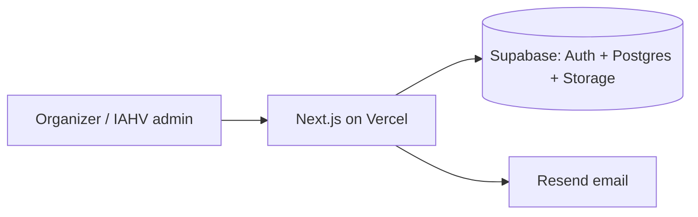
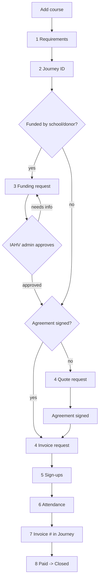
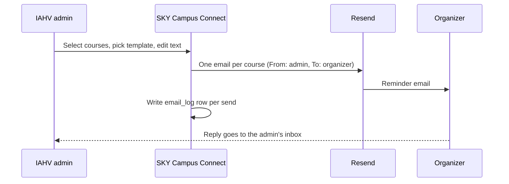

# SKYCampusConnect Plan (v3)

Self-contained plan and the single source of truth for what we build. Part A records what changed from the earlier v2 plan (now removed) and why.

## Part A: Changes from v2, and why

| # | v2 | Change in v3 | Why |
|---|---|---|---|
| 1 | Three roles: organizer, finance, admin | **Two roles: `organizer` and `iahv_admin`.** IAHV admin does everything v2 split between finance and admin (approve funding, enter quote/invoice #, mark paid/closed, send reminders, manage users and templates). | Finance and the SKY Campus team work as one IAHV group; a separate finance role added permissions to manage with no benefit. |
| 2 | Organizers re-enter similar data for each course | **Form templates.** While filling any form, a user can "Save as template", then "Start from template" next time to prefill it. | The forms barely change between courses (same university, billing contact, teachers, course type). Saves re-typing. |
| 3 | Emails described loosely ("send emails", Resend, templates) | **Reminder emails are defined:** an IAHV admin sends them, **to** the course organizer's email, **from** the sending admin's email, with pre-written text the admin can edit before sending. | Makes clear who sends, who receives, and what the message says (e.g. "please request the invoice for UMD Spring Retreat"). |
| 4 | Daily cron runs a rule engine that sends automatic reminders | **No cron and no automatic emails.** Reminders are sent by hand from the admin dashboard. "Overdue" and "needs follow-up" are worked out when the page loads. | Not needed; admins decide when to nudge. Removes scheduled jobs, idempotency logic and send-rule config. |

Smaller knock-on changes:
- Settings page no longer has reminder rules; it has users/roles, email templates, pricing constants.
- The frontend's "Automatic reminders" panel on `/admin/reminders` is removed (see *Frontend changes*).
- RLS and the `events` audit log use the two roles.

## Part B: Plan

### What we're building
One web app that walks SKY Campus organizers through the 8 course steps, sends their requests to IAHV, and gives IAHV admins one live view of every course, funding request, quote and invoice. Replaces Google Forms, the Finance spreadsheet and one-by-one reminder messages.

**Stack:** Next.js (App Router, TypeScript), Supabase (Auth, Postgres + RLS, Storage), Vercel, Resend (email), Zod (shared validation), Playwright + pgTAP/SQL tests.

### Roles
- **organizer:** sees and edits only their own courses, documents and templates.
- **iahv_admin:** sees all courses; approves funding; enters quote/invoice numbers; marks paid/closed; sends reminder emails; manages users, roles, email templates and pricing constants.

New sign-ins become organizers. Only an IAHV admin can make someone an admin.

### Pages
**Shared:** Sign-in (magic link; campus domains for organizers, invited emails for admins), profile, **My templates** (list, rename, delete).

**Organizer**
- My courses: cards with progress bar, "next action", blockers.
- Add course: dates, campus, course type, format, teachers, est. participants, who pays. **"Start from template"** at the top.
- Course detail: 8-step stepper. Each step has a status (`locked | todo | in_progress | waiting_on_iahv | done | skipped`), help text and its form.
  - Step 4 shows the quote or invoice form depending on routing.
  - Steps 7-8 show copy-ready Journey text ("invoice # X for $Y paid by ... on MM/DD") and training links.
  - Every form has **"Save as template"** and **"Start from template"**.

**IAHV admin**
- Dashboard: all courses, filter by campus / step / status / overdue; sort by needed-by date.
- Queues: Funding approvals, Quote requests, Invoice requests, Pending payment, Needs follow-up. Each row has an inline action (approve / enter # / mark paid / send reminder) and its age against the 2-4 business-day target (flag after 10).
- Email reminders: pick recipients (from a queue or selected rows), pick an email template, edit, send. History of sends.
- Settings: users/roles, email templates, pricing constants.

### The 8 steps, with routing
Unchanged from v2:
1. Campus requirements checklist (event, room, funding).
2. Post on Journey, enter Journey course ID.
3. Funding approval (only if school/donor/sponsor-funded; else `skipped`). Computed check: all earlier courses closed. Needs proof PDFs. IAHV admin approves, which unlocks step 4.
4. Quote/invoice:
   - agreement = yes: invoice form (needs agreement upload; can reuse step-3 PDFs).
   - agreement = no/in progress: quote form; invoice unlocks once the agreement is signed.
   - "not at this time" / verbal: quote waived, hidden until needed.
5. Sign-ups + orientation calls; participant count updates pricing.
6. Attendance in Journey (manual checkbox + date).
7. Enter invoice # in Journey course accounting; mark submitted.
8. Track payment: paid, then closed (Journey status updated by hand).

Open ordering conflict (from v2): form 1 says approval before posting; meeting notes say post first to get the Journey ID. Step 3 can be submitted without a Journey ID but needs one before approval. Confirm with Kelsey.

### Form templates (new)
**What it does.** On any form, the user clicks **Save as template**, names it (e.g. "UMD, university-funded, Happiness"), and the current answers are saved. Next time, **Start from template** shows their templates for that form; picking one fills the form, and the user changes what's different and submits.

**Forms that support templates:** Add course (step 1), Funding request (step 3), Quote request and Invoice request (step 4), and the admin's reminder email.

**What a template keeps and what it leaves out.**
- Keeps: things that repeat. University/client name, Attn, billing address, client email, teachers, course type, format, who pays, accounts-payable timing, student-fee choice, agreement status, notes.
- Leaves out: things unique to one course. Course name, dates, Journey course ID, participant counts, PO number, quote/invoice numbers, uploaded files, amounts (always recomputed from pricing).
- Each form defines its allowed fields in one list, shared by the UI and server, so the excluded fields can't slip in.

**Who sees templates.** Templates belong to the user who made them. Organizers see only their own. IAHV admins see their own (shared admin templates are a later option).

**Behavior.**
- If the form already has input, applying a template first asks "Replace what you've typed?".
- Templates store the form's schema version. If a form changes, unknown fields are ignored and missing ones left blank.
- Saving a template never submits the form.

### Reminder emails (clarified)
**Who sends, to whom.**
- **To:** the organizer of each selected course (their profile email). Example: a reminder about UMD Spring Retreat goes to Maya Chen, mchen@umd.edu.
- **From:** the IAHV admin who clicks Send, shown as their name and email (e.g. "Kelsey (IAHV) <kelsey@iahv.org>"). Replies go straight to that admin.
- One email per course, so each has its own details filled in.

**Message.** Each reminder type has pre-written text with fields filled in from the course, for example:

> Hi {{organizer_first_name}},
> Could you please submit the invoice request for {{course_name}} ({{course_dates}})? Your course and university details are already filled in: {{step_4_link}}
> Thank you!
> {{admin_name}}, IAHV

Starting templates: *Request your invoice*, *Submit course accounting*, *Payment overdue*, *Payment coming up*, *Funding needs more info*. The admin can edit subject and body before sending. Admins manage these texts in Settings (and can save edited versions as their own templates, per above).

**Sending.**
1. Admin selects courses (from a queue like "Invoice not requested" or by ticking rows).
2. Picks a template; sees a preview for the first recipient.
3. Optional "Send me a test".
4. Sends. Each send is written to `email_log` and shows on the course and in "Recently sent".

**Implementation note.** Resend can only send *From* addresses on a verified domain. Verify `iahv.org` (or a subdomain) in Resend so each admin's own address can be the From. If that isn't possible, send from `reminders@<verified domain>` with the admin's name and `Reply-To: <admin email>` (open question 8).

### No scheduled jobs
- No cron, no automatic reminders, no reminder-rule engine.
- "Overdue", "Needs follow-up", and SLA ages are calculated in the dashboard query each time the page loads (e.g. `due_date < today AND status <> 'closed'`; `invoice not requested AND start_date <= today`).
- Admins send reminders by hand from those lists.

### Data model (Supabase)
Changes from v2 are marked **(v3)**.
- `profiles(id, name, email, role, campus)`: `role` is `organizer | iahv_admin` **(v3)**
- `campuses(id, name)`; `clients(id, full_name, attn, address, email, country)` reused per university
- `courses(id, organizer_id, campus_id, client_id, name, course_type, format, start_date, end_date, teachers, est_participants, actual_participants, funding_type, funding_source[], funding_amount, agreement_status, journey_course_id, journey_status, currency, country)`
- `course_steps(course_id, step_no, status, completed_at, completed_by, data jsonb)`; current step derived
- `funding_requests(id, course_id, student_fee, prior_funding_note, needed_by, status, reviewer_id, reviewed_at)`
- `quotes(id, course_id, client_id, amount, status, quote_number, version, notes, issued_at)`
- `invoices(id, course_id, client_id, quote_id, po_number, base_amount, cc_fee_applied, amount, due_date, status, invoice_number, is_placeholder, issued_at, sent_at, accounting_submitted_at, paid_at, closed_at)`
- `documents(id, course_id, kind, storage_path, uploaded_by)` + join tables for reuse
- **(v3)** `form_templates(id, owner_id, form_type, name, schema_version, data jsonb, created_at, updated_at)`; `form_type` is `course | funding_request | quote_request | invoice_request | reminder_email`; unique `(owner_id, form_type, name)`
- `email_templates(id, key, name, subject, body, updated_by, updated_at)`
- `email_log(id, course_id, template_id, from_admin_id, from_email, to_email, subject, body, sent_at, status, provider_message_id)` **(v3: from/to explicit; `trigger` column removed, every send is manual)**
- `events(id, course_id, actor_id, type, payload, at)` audit log
- **Removed (v3):** reminder rules / schedules.

Lifecycles (unchanged): invoice `requested -> issued -> sent_to_client -> accounting_submitted -> paid -> closed` (+ `rejected` loop). Quote `requested -> issued -> accepted | revised | expired`. Funding `draft -> submitted -> approved | needs_info`.

**RLS (v3):**
- Organizers read/write their own courses, documents and `form_templates`.
- IAHV admins read/write everything.
- Organizers can't write approval fields, quote/invoice numbers, or admin-only status changes (enforced in Postgres functions/triggers, not just the UI).
- `email_log` insert only by IAHV admins, with `from_admin_id = auth.uid()`. Organizers can read log rows for their own courses.
- Storage bucket policies mirror the above.

### Cross-cutting logic
- **Pricing:** `base = 500 (Happiness) | 1000 (Premium)`; `+100 * max(0, participants-10)`; `x1.03` if card, rounded to cents. An override needs a reason and is flagged for IAHV. Constants live in Settings.
- **Validation (Zod):** full university name (no bare abbreviations), email, end >= start, due >= today, PDF <= 10 MB x5, amount > 0. Template data is validated against the same schemas when applied.
- **Reminders:** manual only (see above). No cron.
- **Journey:** no API assumed. Manual status updates; export/CSV import is a later spike.
- **Privacy:** amounts visible only to the course organizer and IAHV admins; seed data is synthetic.

### Diagrams

### Frontend changes (on top of the `frontend-designs` pages)
- Rename "Finance" wording to "IAHV admin" where it refers to a role (e.g. "IAHV Finance is reviewing" -> "IAHV is reviewing").
- `/admin/reminders`: remove the "Automatic reminders" panel; show From (the signed-in admin) and To (each organizer's email) in the preview; "Recently sent" shows who sent each one.
- Add "Save as template" / "Start from template" controls to the step 1, 3 and 4 forms and the reminder composer; add a "My templates" page.
- Login: two roles only (already the case).

### Build order
0. **Foundation:** Supabase schema + RLS + seed, CI, Vercel deploy, auth with the two roles. Swap `lib/mock-data.ts` functions for queries.
1. **Courses + stepper:** add course, step statuses, my-courses list (steps 1, 2, 5, 6 as simple checklists).
2. **Invoice slice (highest value):** clients, pricing, invoice request form, admin queue to enter invoice #, steps 7-8, lifecycle, overdue flag.
3. **Admin dashboard:** all courses, filters, queues.
4. **Form templates:** `form_templates` table + RLS, save/apply on step 1 and invoice first, then the other forms, My templates page.
5. **Funding approval (step 3) + documents** with reuse.
6. **Quote flow** and routing logic.
7. **Reminder emails:** Resend domain setup, email templates, admin composer with From/To, send log.
8. **Polish:** audit log views, help panels, CSV export, accessibility, E2E tests.

### MVP vs later
- **MVP (build steps 0-4 + 7):** sign-in, courses, invoice request/tracking, dashboard, form templates, manual reminder emails.
- **Next:** funding approval, quotes.
- **Later:** shared admin templates, Journey import, PDF generation, Canada tax, cancellation/dropout rules, Slack notifications.

### Testing
- RLS tests per role: organizers can't see others' courses, amounts or templates, or approve their own requests; only admins can insert `email_log`.
- Unit tests: pricing, validators, routing, template field allow-lists (excluded fields never saved or applied), email merge fields.
- Playwright E2E: organizer happy path using a saved template; admin issues an invoice; admin sends a reminder and it shows in the log with the right From/To.

### Open questions (to confirm)
1. Does IAHV enter quote/invoice # by hand, or should the app generate/PDF them?
2. Who approves funding (Samantha Hanson or another IAHV admin)? A hard gate on posting, or advisory?
3. Journey status: is there an API/CSV, or manual only?
4. Can the flat-rate student fee be partial?
5. Cancellation/dropout payment rules.
6. Is Canada/GST needed for the demo?
7. Login method: IAHV/university SSO, or invited email?
8. **(v3)** Can we verify `iahv.org` in Resend so emails are sent from each admin's own address? If not, use a shared sender with the admin as Reply-To.
9. **(v3)** Should IAHV admins be able to share templates with each other (or with organizers)?
