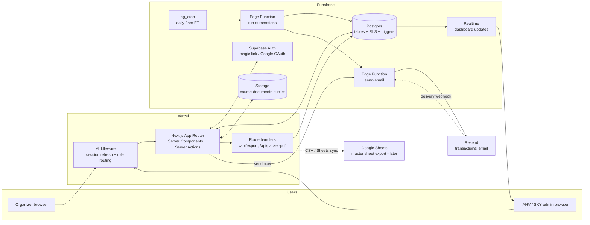
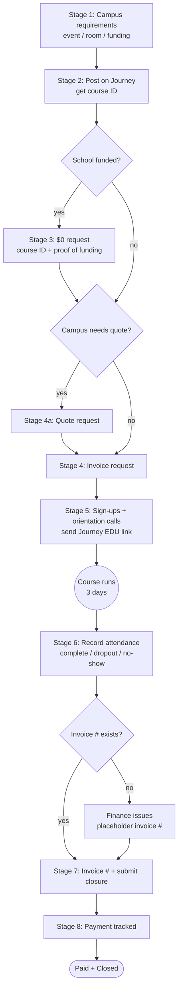
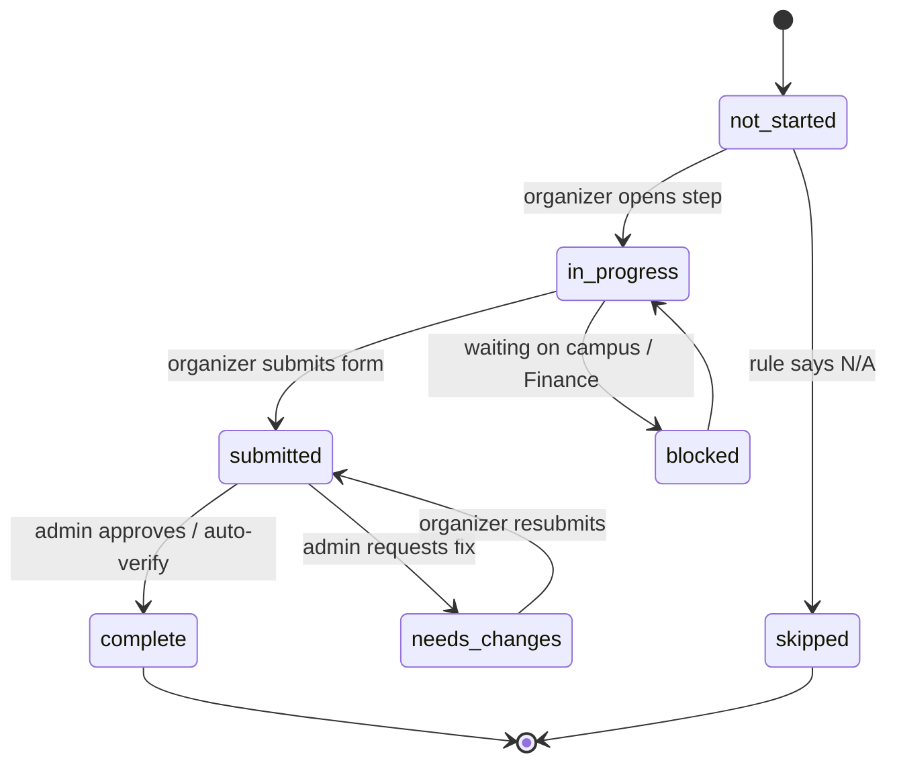
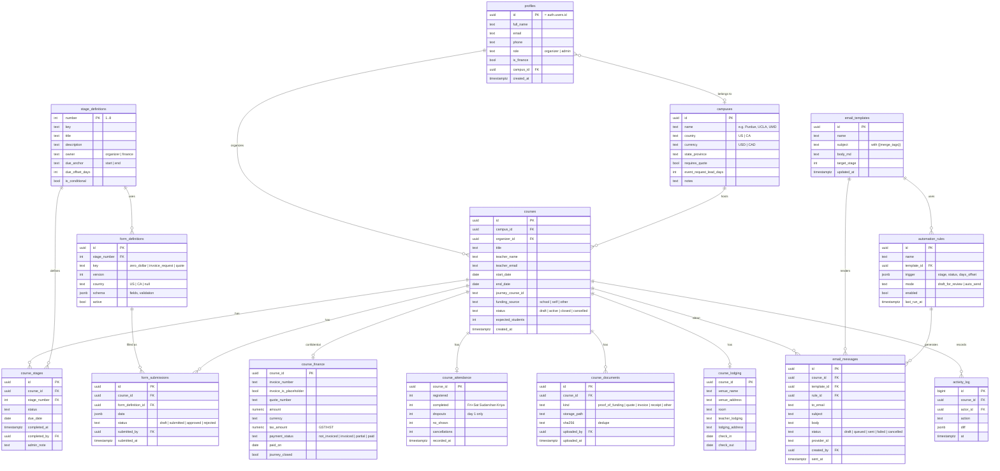
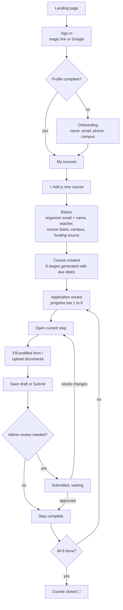
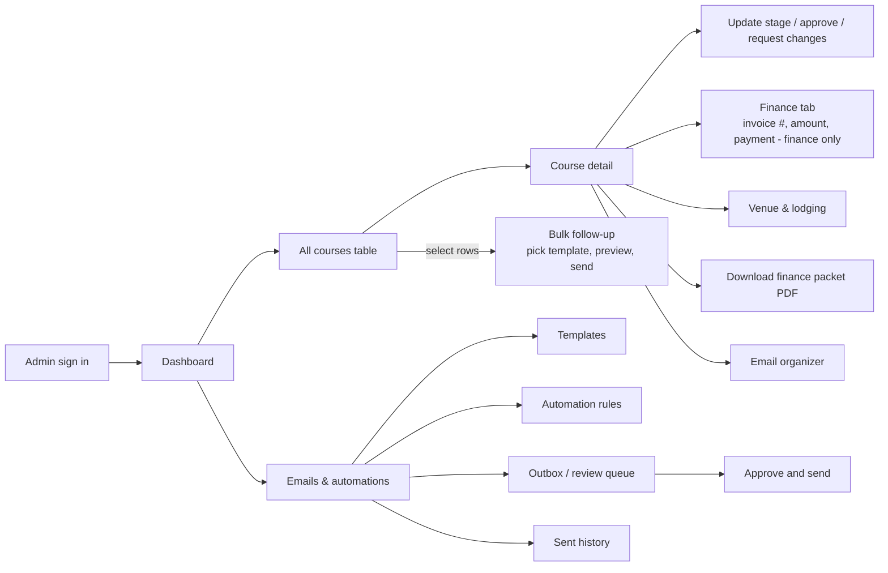
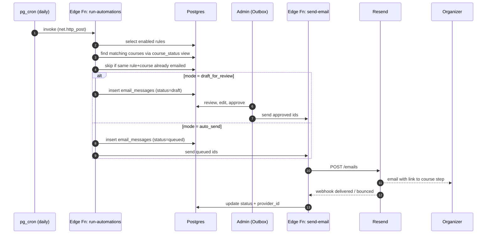
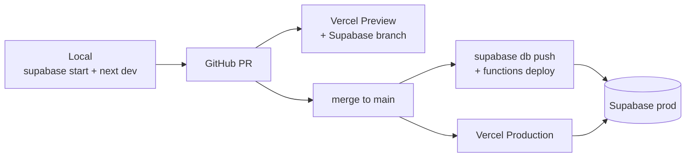

# SKYCampusConnect: Architecture Plan

> Status: **planning only**, no app code yet.
> Stack: **Next.js** (App Router, TypeScript) + **Supabase** (Auth, Postgres, RLS, Storage, Edge Functions, pg_cron) + **Vercel** (hosting, previews).
> Sources: `SKY_Meeting_Notes.md` (Kelsey / Pramukh / Aryan meeting) and `Hackathon_Prompt.md` (Track 5: cut down volunteers' finance paperwork).

---

## 1. Problem and goal

SKY Campus courses (3‑day Journey courses run at universities) go through a funding → registration → accounting → closure workflow that today lives in scattered Google Forms, a manually maintained Finance spreadsheet, and one‑by‑one text reminders from Kelsey. The common failures are:

- Organizers forget to **request an invoice**, submit **course accounting**, or include the **invoice number** at closure.
- The invoice request form is long, so it gets delayed or skipped.
- IAHV Finance tracks open courses and payment status **by hand** in a spreadsheet.
- Reminders go out **too late** (the week of the course) and **one at a time**.

**Goal:** one app that walks organizers through the eight stages, gives IAHV Finance / SKY Campus admins a live view of every course, and replaces one‑by‑one texts with reviewed, status‑based email automations.

### Hackathon fit (Track 5)

| Track 5 pain point | How SKYCampusConnect addresses it |
|---|---|
| Manual finance work by volunteers | Guided 8‑stage wizard; forms prefilled from course data so organizers never retype course ID, dates, campus |
| Handoff to accounts payable | Invoice request, invoice number and closure live on the course record; Finance sees them instantly, no spreadsheet copy |
| Duplicate uploads | Documents (proof of funding, quotes, receipts) stored once per course in Supabase Storage with SHA‑256 dedupe |
| Assembling summary PDFs by hand | One‑click "Course finance packet" PDF (course summary + attached docs) generated server‑side |
| US vs Canada setups | `country` + `currency` (USD/CAD) on campus and course, tax fields (GST/HST) on finance records, country‑specific form variants |

---

## 2. Users and roles

Agreed direction from the meeting: **two profiles**, with SKY Campus admins sharing the admin portal.

| Role | Who | Can do |
|---|---|---|
| `organizer` | Campus organizer / teacher | Sign in, create courses, complete the stage wizard for **their own** courses, upload docs, see their own progress |
| `admin` | IAHV Finance (e.g. Mikayla), SKY Campus HQ (e.g. Kelsey) | See all courses across campuses, filter/sort, update stages, manage email templates and automations, send emails |
| `finance` (flag on admin) | IAHV Finance only | Additionally read/write **confidential** fields: invoice amounts, payment records, older records |

Role is stored on `profiles.role` plus an `is_finance` boolean, and is enforced by Postgres **RLS**, not just by the UI.

---

## 3. System architecture



**Key choices**

- **Next.js on Vercel** with `@supabase/ssr`. Pages are Server Components that query Supabase **as the signed‑in user**, so RLS does the access control. Mutations use Server Actions.
- **Supabase is the whole backend**: Auth, Postgres, Storage, Edge Functions (Deno) for email + automations, `pg_cron` to schedule automation runs, Realtime for the live admin dashboard.
- **Resend** for email (simple API, works from Edge Functions, free tier fits the hackathon). Swappable for SendGrid/Postmark.
- **Service role key** lives only in Edge Functions and Vercel server env, never in the browser.

---

## 4. The eight stages

Taken directly from the meeting notes. Each course has one row per stage in `course_stages`.

| # | Key | Stage | Done when | Who |
|---|---|---|---|---|
| 1 | `campus_requirements` | Follow campus event, room and funding requirements & deadlines | Organizer confirms event request / room booked / funding status (e.g. Purdue needs 2 weeks notice) | Organizer |
| 2 | `journey_posting` | Post course on Journey | Journey **course ID** entered | Organizer |
| 3 | `zero_dollar_request` | $0 request with course ID + proof of funding | Form submitted + proof uploaded. **Skipped** if not school‑funded | Organizer |
| 4 | `quote_invoice_request` | Quote (if school needs one, e.g. UCLA) and invoice request | Invoice request submitted. Quote sub‑step only if `campus.requires_quote` | Organizer → Finance |
| 5 | `signups_orientation` | Student sign‑ups + orientation calls, Journey link sent for EDU verification | Orientation completed, expected headcount entered | Organizer |
| 6 | `attendance` | Record attendance in Journey after the course | Counts entered: complete / dropout / no‑show / cancelled | Teacher / organizer |
| 7 | `accounting_closure` | Enter invoice number in course accounting and submit for closure | Invoice number present + closure submitted in Journey | Organizer (Finance may issue placeholder invoice #) |
| 8 | `payment_closed` | Track payment from school/funder until paid and closed | Payment received + course closed | Finance |

Stage status values: `not_started` · `in_progress` · `submitted` · `needs_changes` · `complete` · `skipped` · `blocked`.



Stage state machine (per stage):



**Derived course status** (computed in a SQL view, used by the dashboard and automations): `current_stage` = lowest stage not `complete`/`skipped`; `is_overdue` when a stage's due date (relative to course start/end) has passed; `health` = `on_track` / `at_risk` / `overdue`.

Default due‑date rules (editable in `stage_definitions`):

| Stage | Due |
|---|---|
| 1 | start − 21 days |
| 2 | start − 21 days |
| 3 | start − 14 days |
| 4 | start − 14 days (Finance allows course day; we nudge early) |
| 5 | start − 3 days |
| 6 | end + 3 days |
| 7 | end + 7 days |
| 8 | end + 45 days |

---

## 5. Data model



**Notes on the model**

- **`course_finance` is split out** so RLS can lock invoice/payment data to `is_finance` admins only (the notes say invoice/payment data is confidential). Organizers can write `invoice_number` through a narrow Server Action, but cannot read amounts.
- **`form_definitions.schema` is JSON**, so new or changed Google Forms (the $0 form, invoice request form) can be added as data without code changes, which the meeting asked for ("add or import future forms if the process changes"). The wizard renders forms from the schema (e.g. with `react-hook-form` + `zod` generated from the schema). Country‑specific variants handle US vs Canada.
- **`course_lodging`** covers "where they're staying": the venue/room on campus and teacher lodging. The meeting notes don't describe lodging, so these fields are a starting assumption to confirm with Kelsey.
- **Prefill everywhere**: course ID, dates, campus, organizer contact flow into every form so organizers don't retype them (the invoice form is the long one).
- A trigger on `courses` insert creates the 8 `course_stages` rows with computed `due_date`s, and marks stage 3 `skipped` when `funding_source <> 'school'`.
- `activity_log` is written by triggers for an audit trail Finance can trust.

### Row Level Security (sketch)

```sql
-- helper
create function is_admin() returns bool language sql stable as $$
  select exists (select 1 from profiles where id = auth.uid() and role = 'admin')
$$;
create function is_finance() returns bool language sql stable as $$
  select exists (select 1 from profiles where id = auth.uid() and role = 'admin' and is_finance)
$$;

-- courses: organizers see their own, admins see all
create policy courses_select on courses for select
  using (organizer_id = auth.uid() or is_admin());
create policy courses_insert on courses for insert
  with check (organizer_id = auth.uid());
create policy courses_update on courses for update
  using (organizer_id = auth.uid() or is_admin());

-- course_stages / form_submissions / documents / attendance / lodging:
--   same pattern via exists (select 1 from courses c where c.id = course_id and (c.organizer_id = auth.uid() or is_admin()))

-- course_finance: finance admins only
create policy finance_all on course_finance for all using (is_finance()) with check (is_finance());

-- email_templates / automation_rules / email_messages: admins only
create policy admin_all on email_templates for all using (is_admin()) with check (is_admin());

-- storage: bucket 'course-documents', path = {course_id}/{file}
--   policy checks the course_id prefix against the same courses rule
```

Admins are promoted manually (SQL or a small "Manage admins" page restricted to existing admins). New sign‑ups default to `organizer`.

---

## 6. Organizer view

**Flow:** sign in → profile (name, email, campus) on first visit → "My courses" → **Add a new course** (email, name, dates, campus) → course page with the step‑by‑step application.



**Pages (App Router)**

```
app/
  (public)/page.tsx                     landing
  (auth)/login/page.tsx                 magic link / Google
  (auth)/auth/callback/route.ts
  onboarding/page.tsx                   profile + campus
  (organizer)/courses/page.tsx          My courses (cards with progress bars)
  (organizer)/courses/new/page.tsx      Add a new course
  (organizer)/courses/[id]/page.tsx     course overview + stepper
  (organizer)/courses/[id]/step/[n]/page.tsx   one stage's form
```

**Wizard UX details**

- Vertical stepper with the 8 stages, each showing status chip and due date ("Invoice request: due in 5 days").
- Each step shows **what to do**, links (Journey, campus resource pages, orientation guide), and the form.
- Forms autosave drafts (`form_submissions.status = 'draft'`).
- Conditional steps (stage 3 $0 request, stage 4a quote) appear only when they apply.
- Stage 6 attendance includes the definitions from the notes: Fri + Sat Sudarshan Kriya = complete; day 1 only = dropout; signed up, never attended = no‑show. Note that dropouts and no‑shows still require payment.
- Stage 7 blocks submit until an invoice number exists, with a "Request placeholder invoice # from Finance" button if it doesn't.

---

## 7. IAHV admin view

Four areas: **Dashboard**, **Courses**, **Course detail**, **Emails & automations**.



**Dashboard** (`/admin`)
- KPI tiles: active courses, courses by current stage, overdue count, invoices not requested, awaiting closure, awaiting payment.
- Pipeline chart: number of courses in each of the 8 stages (funnel / stacked bar).
- "Needs attention" list: overdue stages sorted by days overdue, with one‑click "email organizer".
- Upcoming courses calendar (next 30 days) with venue / lodging.
- Live via Supabase Realtime on `course_stages`.

**All courses** (`/admin/courses`)
- Table: campus, course title, dates, organizer, current stage, per‑stage dots (8 mini indicators), venue/lodging, health, payment status (finance only).
- Filters: campus, country, current stage, health, payment status, date range. Sort any column. Search.
- Multi‑select → bulk email or bulk stage update.
- Export CSV (replaces the manual master spreadsheet; Google Sheets sync later).

**Course detail** (`/admin/courses/[id]`)
- Tabs: Overview & stages · Forms & documents · Venue & lodging · Finance (finance only) · Emails · Activity log.

**Emails & automations** (`/admin/emails`)
- **Templates**: subject + markdown body with merge tags (`{{organizer_name}}`, `{{course_title}}`, `{{campus}}`, `{{start_date}}`, `{{stage_title}}`, `{{due_date}}`, `{{course_link}}`).
- **Automation rules**: "When stage X is not complete N days before/after start/end → template T". Mode `draft_for_review` (default, matches the meeting: "prepare a personalized email for review and sending") or `auto_send`.
- **Outbox / review queue**: drafts generated by rules, grouped by template; admin can edit, approve one, approve all, or cancel.
- **Sent history**: delivery status from the Resend webhook.

Seed automation rules:

| Rule | Trigger | Template |
|---|---|---|
| Kickoff | course created | Welcome + the 8 steps + campus deadlines |
| Invoice nudge | stage 4 not complete, start − 14d | "Request your invoice now" |
| Orientation reminder | stage 5 not complete, start − 10d | "Schedule orientation calls" (fixes "too late" reminder) |
| Attendance due | stage 6 not complete, end + 2d | "Record attendance in Journey" |
| Closure due | stage 7 not complete, end + 7d | "Submit accounting + invoice # for closure" |
| Payment follow‑up | stage 8 not complete, end + 30d | Finance‑internal reminder |

---

## 8. Automation and email pipeline



- **Idempotency**: unique index on `(rule_id, course_id, stage_number)` for automated messages so a rule never double‑sends.
- Merge tags are rendered server‑side; links deep‑link to `/courses/[id]/step/[n]`.
- Manual / bulk emails from the admin UI go through the same `send-email` function so history is in one place.

---

## 9. Finance documents (hackathon Track 5 extras)

- **Upload once**: all docs go to `course-documents/{course_id}/…`; client computes SHA‑256 and the server rejects duplicates per course ("this receipt was already uploaded on Nov 3").
- **Finance packet PDF**: `/api/packet-pdf?course=…` builds a summary page (course, campus, dates, Journey ID, invoice #, attendance counts, currency) and appends uploaded PDFs/images (`pdf-lib`). Replaces "someone makes a summary PDF by hand".
- **US / Canada**: `campuses.country` drives currency (USD/CAD), tax line (GST/HST for CA), and which `form_definitions` variant is shown.
- **Optional stretch**: volunteer expense reimbursements (`expense_claims` table: receipts, amount, currency, tax, status, approver) using the same upload/dedupe/packet pieces.

---

## 10. Repository layout

```
skycampusconnect/
├─ app/                         Next.js routes (see sections 6 and 7)
│  ├─ (organizer)/…
│  ├─ admin/…
│  └─ api/export, api/packet-pdf
├─ components/                  ui (shadcn/ui), Stepper, StageBadge, CourseTable, FormRenderer
├─ lib/
│  ├─ supabase/{server,client,middleware}.ts
│  ├─ stages.ts                 stage metadata + helpers
│  └─ forms/                    schema → zod + react-hook-form
├─ middleware.ts                refresh session, guard /admin
├─ supabase/
│  ├─ migrations/               SQL: tables, RLS, triggers, views, cron
│  ├─ seed.sql                  campuses, stage_definitions, templates, demo courses
│  └─ functions/
│     ├─ send-email/index.ts
│     └─ run-automations/index.ts
├─ types/database.ts            generated by `supabase gen types`
└─ plan.md
```

Libraries: Tailwind + shadcn/ui, TanStack Table (admin table), Recharts (dashboard), react-hook-form + zod, pdf-lib, Resend SDK.

---

## 11. Environments and deployment



| Variable | Where |
|---|---|
| `NEXT_PUBLIC_SUPABASE_URL`, `NEXT_PUBLIC_SUPABASE_ANON_KEY` | Vercel (all envs) |
| `SUPABASE_SERVICE_ROLE_KEY` | Vercel server only + Edge Functions |
| `RESEND_API_KEY`, `EMAIL_FROM` | Edge Function secrets |
| `APP_URL` | Vercel + Edge Functions (for deep links) |

---

## 12. Build plan (hackathon phases)

| Phase | Scope | Demo value |
|---|---|---|
| **0. Setup** (~2h) | Next.js scaffold, Supabase project, auth, profiles, Vercel deploy | Login works on a live URL |
| **1. Core data** (~3h) | Migrations: campuses, courses, stage_definitions, course_stages, triggers, RLS; seed demo data | Courses with 8 stages exist |
| **2. Organizer** (~5h) | My courses, Add new course, stepper wizard, forms for stages 2–7, uploads | Organizer can walk a course end‑to‑end |
| **3. Admin** (~5h) | Dashboard KPIs + pipeline, courses table with filters, course detail, finance tab, CSV export | Finance sees everything live |
| **4. Emails** (~4h) | Templates, outbox, send-email function, bulk follow‑up, run-automations + cron | Overdue courses get reviewed reminder emails in one click |
| **5. Track 5 polish** (~3h) | Dedupe uploads, finance packet PDF, USD/CAD, demo script | Hits all four judge pain points |

Demo script: create a UMD course as an organizer → submit through stage 4 → switch to admin, see it on the dashboard → run automations, review and bulk‑send reminders for overdue courses → record attendance and invoice # → download the finance packet → mark paid and closed.

---

## 13. Open questions (for Kelsey / Mikayla)

1. "Where they're staying": is this the on‑campus venue/room, teacher lodging, or both? (Modeled as both in `course_lodging`.)
2. Exact fields of the **$0 request** and **invoice request** Google Forms (Kelsey to send). Needed to finalize `form_definitions`.
3. Finance spreadsheet column names (template without monetary data) so the CSV export matches what Mikayla already uses.
4. Should invoice amounts be visible to SKY Campus admins, or Finance only? (Plan: Finance only.)
5. Does a **cancellation** carry the same payment consequence as dropout / no‑show?
6. Which address should emails come from, and should automations ever auto‑send, or always wait for review?
7. Is there any Journey API/export, or does Journey data (course ID, attendance, closure) stay manual entry?
8. Canada specifics: which campuses, and does the approval path differ?
