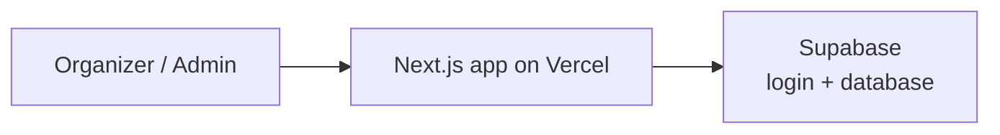
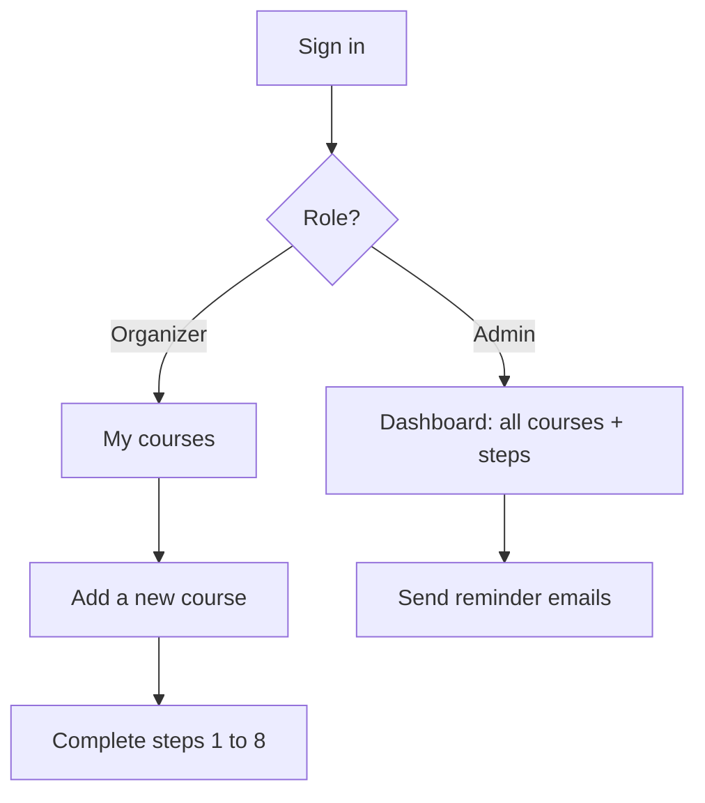

# SKYCampusConnect Plan

## What we're building

One web app that walks SKY Campus organizers through the 8 steps of running a course, and gives IAHV admins a single place to see every course and send reminder emails. It replaces the scattered Google Forms, the manual Finance spreadsheet, and one-by-one reminder texts.

**Stack:** Next.js (frontend + server), Supabase (login + database), Vercel (hosting).

## Pages

**Sign-in page** (everyone)
- Sign in with email. Supabase Auth handles it.
- After signing in, organizers go to their courses and admins go to the dashboard.

**Organizer view**
- **My courses:** list of your courses with a progress bar.
- **Add a new course:** your name, email, campus, and course dates.
- **Course application:** the 8 steps below, one at a time. Fill in each step and mark it done.

**IAHV admin view**
- **Dashboard:** all courses, where they're held/staying, and which of the 8 steps each is on. Filter by campus or step.
- **Emails:** pick courses (e.g. "invoice not requested") and send them a reminder email from a template.

## The 8 steps

1. Follow campus event, room, and funding requirements
2. Post the course on Journey and get the course ID
3. Submit the $0 request with proof of funding (only if school-funded)
4. Request a quote and invoice
5. Collect sign-ups and do orientation calls
6. Record attendance in Journey
7. Enter the invoice number and submit the course for closure
8. Track payment until paid and closed

## Diagrams

How it fits together:

How a user moves through the app:

## Database (Supabase)

- **profiles:** name, email, role (organizer or admin), campus
- **courses:** organizer, campus, dates, venue/lodging, Journey course ID, invoice number, current step (1 to 8)

Supabase row-level security makes sure organizers only see their own courses and admins see all of them.

## Build order

1. Sign-in page and Vercel deploy
2. Organizer: add a course and the 8-step application
3. Admin: dashboard of all courses
4. Admin: reminder emails
